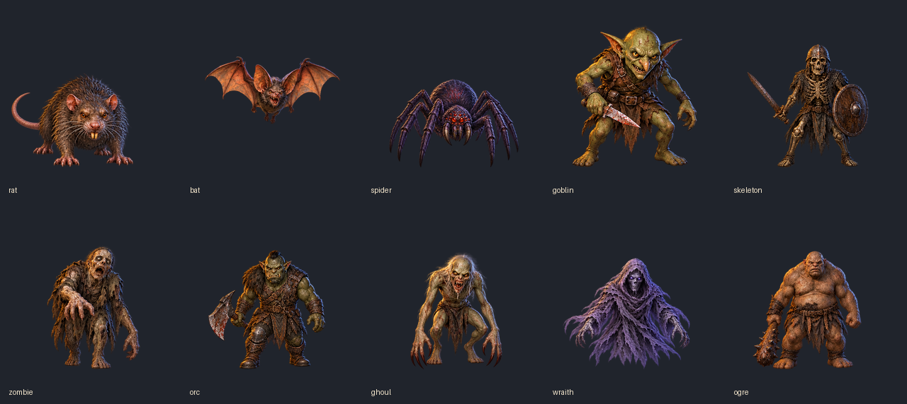

# Batch A art review — updated 23 October 2026

Generated, corrected and integrated on user instruction on 23 October 2026.
Colour and Zombie pose corrections were visually reviewed. Captures now use
the shipped atlases through the real runtime loader; publication checks follow.

[Corrected walking and Zombie poses at native cell size](correction-sheet.png)

[Colour measurements and preserved-pose checks](colour-review.json)

[390px dungeon overview](dungeon/390-overview.png) ·
[320px dungeon overview](dungeon/320-overview.png)

| Creature | Complete nine-pose atlas | 390px idle | 390px preparation | 320px idle | 320px preparation |
|---|---|---|---|---|---|
| rat | [Atlas](rat.webp) | [Idle](dungeon/390-rat-idle.png) | [Wind-up](dungeon/390-rat-windup.png) | [Idle](dungeon/320-rat-idle.png) | [Wind-up](dungeon/320-rat-windup.png) |
| bat | [Atlas](bat.webp) | [Idle](dungeon/390-bat-idle.png) | [Wind-up](dungeon/390-bat-windup.png) | [Idle](dungeon/320-bat-idle.png) | [Wind-up](dungeon/320-bat-windup.png) |
| spider | [Atlas](spider.webp) | [Idle](dungeon/390-spider-idle.png) | [Wind-up](dungeon/390-spider-windup.png) | [Idle](dungeon/320-spider-idle.png) | [Wind-up](dungeon/320-spider-windup.png) |
| goblin | [Atlas](goblin.webp) | [Idle](dungeon/390-goblin-idle.png) | [Wind-up](dungeon/390-goblin-windup.png) | [Idle](dungeon/320-goblin-idle.png) | [Wind-up](dungeon/320-goblin-windup.png) |
| skeleton | [Atlas](skeleton.webp) | [Idle](dungeon/390-skeleton-idle.png) | [Wind-up](dungeon/390-skeleton-windup.png) | [Idle](dungeon/320-skeleton-idle.png) | [Wind-up](dungeon/320-skeleton-windup.png) |
| zombie | [Atlas](zombie.webp) | [Idle](dungeon/390-zombie-idle.png) | [Wind-up](dungeon/390-zombie-windup.png) | [Idle](dungeon/320-zombie-idle.png) | [Wind-up](dungeon/320-zombie-windup.png) |
| orc | [Atlas](orc.webp) | [Idle](dungeon/390-orc-idle.png) | [Wind-up](dungeon/390-orc-windup.png) | [Idle](dungeon/320-orc-idle.png) | [Wind-up](dungeon/320-orc-windup.png) |
| ghoul | [Atlas](ghoul.webp) | [Idle](dungeon/390-ghoul-idle.png) | [Wind-up](dungeon/390-ghoul-windup.png) | [Idle](dungeon/320-ghoul-idle.png) | [Wind-up](dungeon/320-ghoul-windup.png) |
| wraith | [Atlas](wraith.webp) | [Idle](dungeon/390-wraith-idle.png) | [Wind-up](dungeon/390-wraith-windup.png) | [Idle](dungeon/320-wraith-idle.png) | [Wind-up](dungeon/320-wraith-windup.png) |
| ogre | [Atlas](ogre.webp) | [Idle](dungeon/390-ogre-idle.png) | [Wind-up](dungeon/390-ogre-windup.png) | [Idle](dungeon/320-ogre-idle.png) | [Wind-up](dungeon/320-ogre-windup.png) |

The ten unmodified generated source sheets are preserved one directory above as
`<kind>.png`. The atlas exports apply the recorded step repairs and cell ordering.
Exact prompts, identity/style references and tool output paths are in
[the generation manifest](../generation-batch-a.json). The tool did not disclose
its underlying model. All drawing and repairs used `image_gen.imagegen`.

## Repairs and registration

- Goblin: original walking cells repeated the right lead. `goblin-stepB.png`
  supplies a left-leading step, with its knife still in the right hand.
- Orc: original steps and the first repair repeated the right lead. The first
  attempt remains as `orc-stepB-rejected.png`. A second image edit produced
  `orc-stepB.png`, advancing the left leg while retaining right-hand axe,
  shoulder fur and right-knee plate placement.
- Ogre: `ogre-stepB.png` supplies the opposite lead, preserving the right-hand
  club and attached arm, wrist and grip.
- Zombie and Ghoul: the source's two steps already alternate but are reversed;
  the manifest swaps their extraction order without mirroring either figure.
- Bat: nine measured torso anchors register to (128,148); wing bounds do not
  determine body height. Wraith registers its lowest solid robe fringe to
  row 236 and retains no physical feet. Other creatures share row 236 for
  visible foot baselines. Each creature uses a single scale across its sheet;
  separately generated steps are first normalised to the original step height.
- Export measurements and source/export hashes are in `measurements.json`.
  All visible alpha bounds retain at least 12px clearance on the other edges.

## Visual review

Sources and 256px cells were inspected together for frontal identity, complete
appendages, gear continuity and cell order. Rat retains rodent incisors, four
legs and one tail; Bat has attached wing membranes, two hind feet and no extra
arms. Spider retains its eight-leg layout, palps, paired fangs and red markings;
its rear leg roots overlap at the small export size. Goblin, Skeleton, Orc and
Ogre retain their weapon hands and connected grips; Skeleton also retains its
left-hand shield, empty sockets and bone joints. Zombie remains fleshy and
heavy; Ghoul remains gaunt with long attached claws. Wraith retains a visible
skull, purple hood and two spectral arms without adding feet or eyelids.

The Wraith reserve/special cell raises both hands but does not include a
separate palm orb; its cold light is concentrated in the skull. Existing spell
effects are unchanged. Replacement steps have small brushwork and proportion
variations from their original sheets; owner review should include the full
walking sequence when reviewing the art. No detached effects or scenery were
introduced to hide connections.

## Verification and scope

### Pre-correction colour review — 22 October 2026

All 90 exported poses were compared against their own species' idle palette.
The previous review covered identity, anatomy and fitting but missed colour
drift in the separately generated replacements. These findings describe the three Step B cells
before the 23 October corrections:

| Creature | Visual finding | Median saturation change | Median value change |
|---|---|---|---|
| Orc | Clear warmer, brighter and more saturated skin, leather and metal highlights | +9.8 percentage points | +8.6 percentage points |
| Ogre | Brighter, more orange skin and stronger warm highlights | +3.1 percentage points | +7.1 percentage points |
| Goblin | Smaller brightness and warm-colour shift in the replacement | +0.4 percentage points | +3.5 percentage points |

Measurements use HSV medians of pixels with alpha ≥224 and value between
0.15 and 0.85 in each 256px cell, compared with idle. They screen for overall
shifts; changed proportions of visible skin, clothing and highlights also
affect these values. They are not a per-material colour match or an automatic
pass/fail threshold. The visual comparison is the basis for flagging these
three frames. The shifts are already visible in the generated replacement
PNGs; the exporter does not apply per-pose colour grading.

Rat, Bat, Spider, Skeleton, Ghoul and Wraith show no similarly clear
replacement-palette outlier. Their smaller differences track exposed materials,
pose shading and warm/cool rim lighting; they should not be described as
pixel-identical colour matches. No artwork was recoloured during this audit.

Checks completed:

- Export `--check`: ten nine-pose atlases, contact sheet and registration
  measurements reproduced byte for byte.
- Actual dungeon captures: ten creatures × idle/preparation × two widths, plus ten corrected-pose views =
  50 captures, including the corrected walking frames and Zombie hurt/blink;
  all creatures were drawn and all preparation warnings present.
  No browser page/console errors. See `dungeon/review.json` for draw metrics.
- `npm run check:agents`: source instructions and generated copy match.
- `npm run check:art`: all source, preview and shipped-art hashes current;
  the original review did not yet change the shipped offline inventory.
- `npm run test:release`: 17 checks passed.
- `release.spec.js`: six checks passed across both Chromium phone projects,
  including installed offline release identity. These verify the unchanged
  shipped game, not offline integration of the preview assets.

At the initial generation/review stage, the preview script used temporary
browser routes and changed no runtime files. The integration checks listed
below supersede that preview-only status. No balance simulations are required
because gameplay is unchanged.

### Pre-correction Zombie follow-up

A closer comparison of all nine Zombie poses with the original source finds
subtler local differences that the whole-frame HSV medians did not establish:
the wind-up face appears paler than idle, and the hurt pose exposes a brighter
chest. The overall palette is close, but skin and lighting still need matching
across those poses before approval. The final blink cell also lowers/straightens
the head and closes the mouth as well as the eyes, so it does not preserve the
idle expression and can produce a visible change during a blink. Walking leads
alternate after the recorded export reordering; no obvious detached limbs were
found. These findings qualify the earlier broad palette assessment. Artwork has
not been modified during this check.

## Corrections reviewed — 23 October 2026

The image-generation tool revised Goblin, Orc and Ogre Step B against their
original idle palettes. Orc's excess orange/gold saturation and brightness
were reduced; Ogre's orange skin cast and bright highlights were reduced.
Goblin was compared across several edits. The selected correction was matched
to idle and Step A within the complete atlas; only its top-right Step B cell
is used, keeping the eight other original source poses. The pre-correction common scale is
retained to preserve their registration. Small painted lighting
and brushwork variations remain; these are not identical per-material pixel
palettes.

Zombie's wind-up and hurt skin lighting were revised, and blink now retains
the tilted idle head, open mouth and reaching posture with closed eyes. The
exporter selects only those three cells from `zombie-colour.png`; the six
other original source poses remain in use. Their exported alpha silhouettes
were checked against the pre-correction atlas and match exactly. Goblin's
eight untouched pose silhouettes were checked the same way. All earlier
PNGs and rejected colour attempts remain as provenance; active selections and
exact image-edit prompts are recorded in the generation manifest.

The correction sheet compares idle, both walking leads and the four relevant
Zombie poses at 256px cell size. Actual dungeon previews also include the
three replacement steps and Zombie hurt/blink at both phone widths. The
pre-correction findings above are historical and do not describe the selected
revised cells. No gameplay or runtime integration was added.

## Runtime integration — 23 October 2026

The user subsequently instructed integration and publication. The historical
preview-only findings above describe the earlier review stage. All ten selected
atlases are now shipped byte for byte and bound only to supported existing poses.
The offline cache includes all ten files. Named champions keep their identities.
The refreshed 50 dungeon captures use the actual runtime loader and shipped
images, with no substituted routes and no page or console errors. Wind-up
warnings remain visible at both widths. See `integration-checks.md` for regression
results; this presentation change does not require balance simulations.
