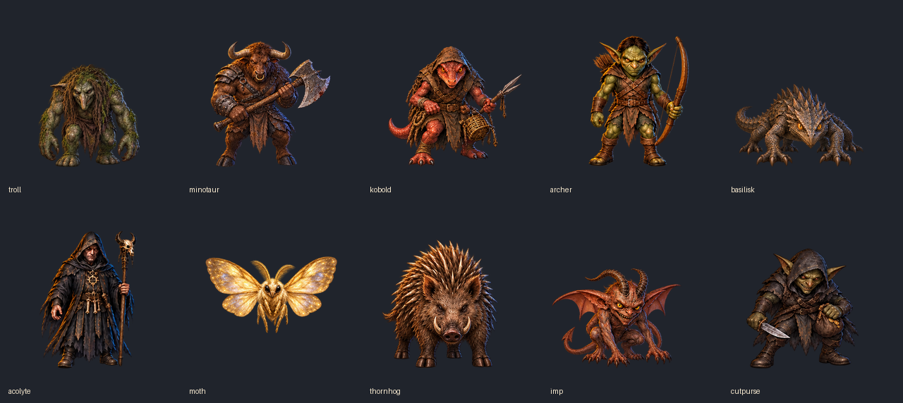

# Batch B artwork review — 23 October 2026

Ten reviewed nine-pose atlases are integrated on the user’s publishing instruction.
Shipped WebPs match review exports byte for byte and are cached offline.
The captures use the actual runtime loader. Existing gameplay and named champion
identities are preserved.

[Walking comparison](walking-sheet.png) · [Action comparison](actions-sheet.png) ·
[Colour screening measurements](colour-review.json)

[390px dungeon overview](dungeon/390-overview.png) · [320px dungeon overview](dungeon/320-overview.png)

| Creature | Nine-pose atlas | 390px idle | 390px wind-up | 320px wind-up |
|---|---|---|---|---|
| Troll | [Atlas](troll.webp) | [Idle](dungeon/390-troll-idle.png) | [Wind-up](dungeon/390-troll-windup.png) | [Wind-up](dungeon/320-troll-windup.png) |
| Minotaur | [Atlas](minotaur.webp) | [Idle](dungeon/390-minotaur-idle.png) | [Wind-up](dungeon/390-minotaur-windup.png) | [Wind-up](dungeon/320-minotaur-windup.png) |
| Kobold Trapper | [Atlas](kobold.webp) | [Idle](dungeon/390-kobold-idle.png) | [Wind-up](dungeon/390-kobold-windup.png) | [Wind-up](dungeon/320-kobold-windup.png) |
| Goblin Archer | [Atlas](archer.webp) | [Idle](dungeon/390-archer-idle.png) | [Wind-up](dungeon/390-archer-windup.png) | [Wind-up](dungeon/320-archer-windup.png) |
| Basilisk | [Atlas](basilisk.webp) | [Idle](dungeon/390-basilisk-idle.png) | [Wind-up](dungeon/390-basilisk-windup.png) | [Wind-up](dungeon/320-basilisk-windup.png) |
| Dark Acolyte | [Atlas](acolyte.webp) | [Idle](dungeon/390-acolyte-idle.png) | [Wind-up](dungeon/390-acolyte-windup.png) | [Wind-up](dungeon/320-acolyte-windup.png) |
| Glimmer Moth | [Atlas](moth.webp) | [Idle](dungeon/390-moth-idle.png) | [Wind-up](dungeon/390-moth-windup.png) | [Wind-up](dungeon/320-moth-windup.png) |
| Thornhog | [Atlas](thornhog.webp) | [Idle](dungeon/390-thornhog-idle.png) | [Wind-up](dungeon/390-thornhog-windup.png) | [Wind-up](dungeon/320-thornhog-windup.png) |
| Gutter Imp | [Atlas](imp.webp) | [Idle](dungeon/390-imp-idle.png) | [Wind-up](dungeon/390-imp-windup.png) | [Wind-up](dungeon/320-imp-windup.png) |
| Goblin Cutpurse | [Atlas](cutpurse.webp) | [Idle](dungeon/390-cutpurse-idle.png) | [Wind-up](dungeon/390-cutpurse-windup.png) | [Wind-up](dungeon/320-cutpurse-windup.png) |

## Sources and repairs

Every original `<kind>.png` is preserved one directory above. Exact prompts,
identity/style references, generated paths and selected sources are in
[the manifest](../generation-batch-b.json). All drawing and image edits used
`image_gen.imagegen`; its underlying model was not disclosed.

- Troll and Cutpurse originally repeated the same walking lead. Tool-drawn
  replacements advance the opposite leg while retaining body/gear orientation.
  The first Troll replacement's opaque gradient was rejected, then removed by
  another tool edit. Further full-sheet palette edits produced the selected
  coherent nine-pose sheets. Mixing only one recoloured frame with the original
  lighting still showed a shift, so all nine cells use the final revised sheets.
- Kobold uses `kobold-frontal.png`: all nine snouts face the viewer, with the
  spear retained in the left hand and dart action in the right.
- Archer and Acolyte use their `*-spacing.png` sheets, separating neighbouring
  bow/staff tips that touched across the original rows. Archer's release has
  no arrow on its string; wind-up and fire-arrow preparation retain the nock.
- Minotaur's hands remain on one continuous axe haft. Basilisk retains three
  leg pairs. Thornhog keeps four cloven-hoof legs and rooted quills. Imp has
  separate arm and wing roots, one tail and no incidental portrait cup.
- Moth retains four wing lobes, six legs and two antennae. Its last cell is an
  antenna/wing idle variation, without invented eyelids. The current runtime
  already has a `blink` object for Moth; this review adds no pose object.

## Registration and colour review

Each 768px WebP contains nine 256px cells with one shared per-creature scale.
Grounded visible feet end on row 236. Moth uses recorded thorax anchors at
(128,144), so changing wing extrema do not set its vertical registration.
Every visible-alpha boundary retains at least 12px clearance.

The exporter only extracts, uniformly scales and registers the tool-drawn art.
It applies no per-pose colour grade. Full-sheet palette selections keep Troll
and Cutpurse's skin and clothing coherent. Other poses retain the fixed warm
upper-left light and restrained cool rim; natural shading/exposed materials
vary with pose. HSV medians are whole-frame screening measurements, not proof
of exact RGB or per-material equality. The visual comparison is decisive.

## Verification

- Export `--check`: all ten atlases, three contact/comparison sheets and
  registration measurements reproduce byte for byte.
- All 90 cells are distinct and retain the required transparent margins;
  grounded baselines stay on row 236 (within decoded-alpha edge tolerance).
- 100 dungeon captures at 390px/320px: every creature drawn, all wind-up/special
  warnings visible, no browser page or console errors. Ranged preparations
  use their existing shot/magic warning kinds. See `dungeon/review.json`.
- `npm run check:art`, `npm run check:agents` and Node syntax checks validate
  the recorded inventory, contributor guidance and capture script.

The capture script loads shipped atlases through the actual runtime loader. It
captures idle, both steps and wind-up for every creature, supported specials,
and Minotaur/Kobold/Archer strikes, at 390px and 320px.

Unused Troll, Minotaur and Kobold reserve cells do not create special abilities
or bypass existing wind-up fallbacks. No combat rules, timings, saves,
visibility or random-number streams changed, so balance simulations are not
needed. See [integration checks](integration-checks.md) for release validation.
