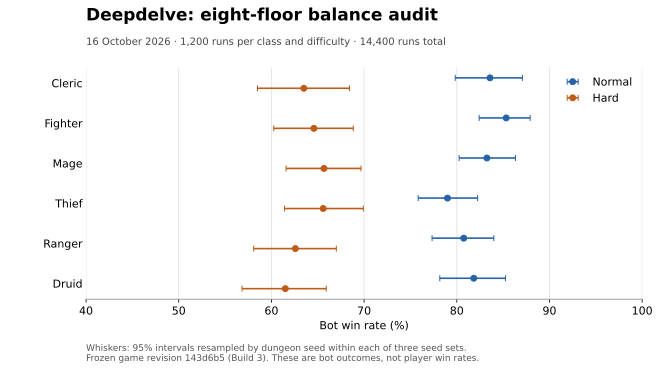

# Balance audit — 16 October 2026

This audit measures the current eight-floor game on Normal and Hard. It does
not change the game rules or the bot's decisions.

## Scope and provenance

- Game revision: `143d6b5bcdac3dd40d43ae58ac1b3643ac833497`, release 1.0.0,
  build 3. The game's `js/` tree is `dc6d872d8d7988ac806b450f1462bbc640b4dd3c`.
- Six classes, two difficulties, three seed sets: `bench0`–`bench39`,
  `alt0`–`alt39`, and `third0`–`third39`.
- 10 trials per dungeon seed: 400 runs per class, difficulty and set;
  1,200 per class and difficulty; 14,400 runs in total.
- `FIT=1`, eight Medium floors, normal monster density and treasure,
  locked doors and traps on, `permadeath=false`, no ladder rung or vows.
  Each run starts with fresh storage, the ordinary starting kit and no
  accumulated meta-progression.
- Backgrounds rotate through Oathbroken, Tombwise, Ashborn, Cloistered,
  Deepborn and Debtor. The default bot alternates paths; capstones alternate
  in pairs. It heads towards the stairs, recruits companions when available,
  and uses its existing combat, healing, shopping and encounter policies.
- Node v24.19.0 ran the simulations; Python 3.12.14 scheduled and analysed them.
- Four independent Node processes ran batches. Other playtest environment
  switches were cleared before applying each batch's recorded settings.
- The snapshot's only patch is the optional JSON export in
  [bench-export.patch](bench-export.patch). It runs after every simulation
  has finished. Its playtest source SHA-256 is
  `c0b0b031e3aac6ee2bfac8870cabc425dfb04aaf750169568955a0b6281b1b99`.
  Comments were clarified in the main checkout afterwards; the bot's decisions
  and the game files remain unchanged.

## Results

All 36 batches completed: **14,400 runs, zero errors and zero timeouts**. The game
rules and the bot’s decisions were left unchanged. The published README rates
were already close to these measurements; this pass adds exact counts and diagnostics.



| Difficulty | Wins / runs | Win rate | Overall seed-cluster 95% interval | Strongest–weakest observed classes | Spread | ≤6-point target? |
| --- | --- | --- | --- | --- | --- | --- |
| Normal | 5925 / 7200 | 82.29% | 80.13–84.40% | Fighter–Thief | 6.33 points | No, marginally above |
| Hard | 4601 / 7200 | 63.90% | 60.82–66.85% | Mage–Druid | 4.17 points | Yes, in this sample |

The target column describes the observed sample, not a guarantee about all seeds.
For the observed Normal Fighter–Thief pair, the difference interval is **2.91–9.75
points**. It spans the six-point limit. The corresponding exploratory Hard
Mage–Druid interval is **−0.92–9.33 points**. These were selected pairs, not
pre-specified hypothesis tests.

### Class rates by seed set

Each set contributes 400 runs per class; the pooled columns use 1,200.

| Difficulty | Class | bench | alt | third | Pooled wins / runs (rate) | Seed-cluster 95% interval |
| --- | --- | --- | --- | --- | --- | --- |
| Normal | Cleric | 85.50% | 82.25% | 83.00% | 1003 / 1200 (83.58%) | 79.83–87.08% |
| Normal | Fighter | 88.25% | 84.75% | 83.00% | 1024 / 1200 (85.33%) | 82.42–87.92% |
| Normal | Mage | 82.00% | 86.00% | 81.75% | 999 / 1200 (83.25%) | 80.25–86.33% |
| Normal | Thief | 81.00% | 80.25% | 75.75% | 948 / 1200 (79.00%) | 75.83–82.25% |
| Normal | Ranger | 78.50% | 82.25% | 81.50% | 969 / 1200 (80.75%) | 77.33–84.00% |
| Normal | Druid | 83.75% | 80.25% | 81.50% | 982 / 1200 (81.83%) | 78.17–85.25% |
| Hard | Cleric | 66.25% | 59.25% | 65.00% | 762 / 1200 (63.50%) | 58.50–68.42% |
| Hard | Fighter | 65.25% | 64.75% | 63.75% | 775 / 1200 (64.58%) | 60.25–68.83% |
| Hard | Mage | 66.50% | 66.75% | 63.75% | 788 / 1200 (65.67%) | 61.58–69.67% |
| Hard | Thief | 69.25% | 66.75% | 60.75% | 787 / 1200 (65.58%) | 61.42–69.92% |
| Hard | Ranger | 64.75% | 64.00% | 59.00% | 751 / 1200 (62.58%) | 58.08–67.00% |
| Hard | Druid | 62.00% | 56.25% | 66.25% | 738 / 1200 (61.50%) | 56.83–65.92% |

### Death timing and progress

| Difficulty | Class | Deaths before a path | Floor-1 deaths | Deaths below level 5 | Average deepest floor | Final-floor deaths / arrivals |
| --- | --- | --- | --- | --- | --- | --- |
| Normal | Cleric | 7 / 1200 | 2 / 1200 | 40 / 1200 | 7.70 | 70 / 1073 (6.52%) |
| Normal | Fighter | 9 / 1200 | 0 / 1200 | 53 / 1200 | 7.68 | 60 / 1084 (5.54%) |
| Normal | Mage | 24 / 1200 | 8 / 1200 | 61 / 1200 | 7.64 | 84 / 1083 (7.76%) |
| Normal | Thief | 23 / 1200 | 4 / 1200 | 72 / 1200 | 7.55 | 99 / 1047 (9.46%) |
| Normal | Ranger | 6 / 1200 | 0 / 1200 | 24 / 1200 | 7.78 | 123 / 1092 (11.26%) |
| Normal | Druid | 21 / 1200 | 4 / 1200 | 51 / 1200 | 7.67 | 82 / 1064 (7.71%) |
| Hard | Cleric | 23 / 1200 | 9 / 1200 | 89 / 1200 | 7.35 | 160 / 922 (17.35%) |
| Hard | Fighter | 44 / 1200 | 8 / 1200 | 156 / 1200 | 7.06 | 95 / 870 (10.92%) |
| Hard | Mage | 57 / 1200 | 26 / 1200 | 119 / 1200 | 7.21 | 141 / 929 (15.18%) |
| Hard | Thief | 47 / 1200 | 11 / 1200 | 116 / 1200 | 7.18 | 114 / 901 (12.65%) |
| Hard | Ranger | 9 / 1200 | 0 / 1200 | 43 / 1200 | 7.48 | 162 / 913 (17.74%) |
| Hard | Druid | 47 / 1200 | 12 / 1200 | 107 / 1200 | 7.30 | 192 / 930 (20.65%) |

### Conditional path rates

These denominators exclude runs that died before choosing a path. They also use
different backgrounds, so the apparent gaps are priorities for matched testing,
not estimates of a path’s causal effect. The background split is described below.

| Difficulty | Class | First path: wins / selected runs | Second path: wins / selected runs | Absolute rate gap |
| --- | --- | --- | --- | --- |
| Normal | Cleric | Templar: 499 / 594 (84.01%) | Healer: 504 / 599 (84.14%) | 0.13 points |
| Normal | Fighter | Knight: 500 / 597 (83.75%) | Berserker: 524 / 594 (88.22%) | 4.46 points |
| Normal | Mage | Pyromancer: 496 / 595 (83.36%) | Frostweaver: 503 / 581 (86.57%) | 3.21 points |
| Normal | Thief | Assassin: 473 / 594 (79.63%) | Trickster: 475 / 583 (81.48%) | 1.85 points |
| Normal | Ranger | Sharpshooter: 487 / 598 (81.44%) | Warden: 482 / 596 (80.87%) | 0.57 points |
| Normal | Druid | Shapeshifter: 477 / 594 (80.30%) | Grovewarden: 505 / 585 (86.32%) | 6.02 points |
| Hard | Cleric | Templar: 400 / 587 (68.14%) | Healer: 362 / 590 (61.36%) | 6.79 points |
| Hard | Fighter | Knight: 359 / 574 (62.54%) | Berserker: 416 / 582 (71.48%) | 8.93 points |
| Hard | Mage | Pyromancer: 365 / 574 (63.59%) | Frostweaver: 423 / 569 (74.34%) | 10.75 points |
| Hard | Thief | Assassin: 386 / 578 (66.78%) | Trickster: 401 / 575 (69.74%) | 2.96 points |
| Hard | Ranger | Sharpshooter: 385 / 594 (64.81%) | Warden: 366 / 597 (61.31%) | 3.51 points |
| Hard | Druid | Shapeshifter: 353 / 570 (61.93%) | Grovewarden: 385 / 583 (66.04%) | 4.11 points |

### Resources

Means include wins and losses. Potion attempts can be blocked; actual healing
casts come from the game’s spell counters. Carried potions are inventory units.

| Difficulty | Class | Healing-potion attempts / run | Actual healing casts / run | Rests / run | Gold remaining / run | Healing potions at death | Deaths with healing potions |
| --- | --- | --- | --- | --- | --- | --- | --- |
| Normal | Cleric | 3.58 | 3.68 | 16.45 | 362.3 | 0.53 | 32 / 197 |
| Normal | Fighter | 2.64 | 0.00 | 9.31 | 335.2 | 1.41 | 76 / 176 |
| Normal | Mage | 1.65 | 0.00 | 8.32 | 353.4 | 1.77 | 92 / 201 |
| Normal | Thief | 2.45 | 0.00 | 6.71 | 375.1 | 2.13 | 143 / 252 |
| Normal | Ranger | 3.18 | 0.00 | 7.09 | 356.1 | 1.37 | 81 / 231 |
| Normal | Druid | 1.97 | 0.08 | 5.59 | 337.7 | 1.99 | 120 / 218 |
| Hard | Cleric | 4.95 | 5.32 | 11.79 | 297.7 | 0.24 | 43 / 438 |
| Hard | Fighter | 3.61 | 0.00 | 8.57 | 311.2 | 1.02 | 132 / 425 |
| Hard | Mage | 2.65 | 0.00 | 8.49 | 320.5 | 1.69 | 192 / 412 |
| Hard | Thief | 3.41 | 0.00 | 6.97 | 349.4 | 1.73 | 212 / 413 |
| Hard | Ranger | 4.51 | 0.00 | 7.20 | 320.5 | 1.15 | 138 / 449 |
| Hard | Druid | 3.45 | 0.15 | 6.16 | 294.0 | 1.52 | 191 / 462 |

### Final-floor preparation on Hard

| Class | Arrival records | Mean hero level | Mean health fraction on entry | Healing potions on entry | Deaths on the final floor |
| --- | --- | --- | --- | --- | --- |
| Cleric | 922 | 7.48 | 79.8% | 3.97 | 160 / 922 |
| Fighter | 870 | 7.46 | 73.5% | 4.27 | 95 / 870 |
| Mage | 929 | 7.57 | 87.0% | 5.56 | 141 / 929 |
| Thief | 901 | 7.41 | 80.5% | 5.04 | 114 / 901 |
| Ranger | 913 | 7.54 | 78.5% | 4.80 | 162 / 913 |
| Druid | 930 | 7.33 | 87.9% | 5.37 | 192 / 930 |

Entry records omit spell points and bear-hide state. A targeted trace is needed
to assess those parts of readiness.

### Interpretation and next measurements

1. **Keep the Normal exception visible.** Fighter won 1,024 runs and Thief 948:
   a 76-win difference out of 1,200, or 6.33 points. Of the extra Thief deaths,
   14 occurred before choosing a path, 23 afterwards but before floor 8, and
   39 on floor 8. This is not solely an opening-health problem. In addition,
   143 of 252 Thief losses still carried healing potions. Investigate burst
   damage and action/healing timing before adding more potions or a blind buff.
   The point estimate narrowly misses the target, while its uncertainty spans
   that limit; no numeric rule change was made from this pass alone.

2. **Inspect Hard Druid’s final-floor fights.**
   Its third set won 66.25%, bringing its pooled rate to 61.5%; Hard’s complete
   class spread is within the observed target. Druid lost 192 of 930 final-floor
   arrivals (20.65%), versus Fighter’s 95 of 870 (10.92%), despite entering with
   about 88% health and 5.37 healing potions on average. The bot favours keeping
   or taking bear form before Mending Moss in a nearby fight, and averaged only
   0.15 actual healing casts per run. Boss fights and that existing policy are
   worth inspecting before attributing those late losses to class numbers.

3. **Measure paths with matching backgrounds before tuning them.** On Hard,
   Frostweaver and Pyromancer differ by about 10.8 points, and Berserker and
   Knight by about 8.9, under the existing confounded assignment. These are
   useful next experiments: force each path on identical seeds, trial counts,
   backgrounds and settings. Preserve this baseline and its bot policy so that
   future rule changes have a reproducible comparison.

## How to read the measurements

Win rates use every attempted run in the denominator. Deaths and timeouts are
separate outcomes; any errors invalidate the audit. Average depth includes both
wins and losses. A victory reaches floor 8.

“Before path” means a death with no path chosen. The older `EARLY=1` diagnostic
counts deaths below level 5, even though paths are now offered at level 3 or at
the divided stair. These are different measures and both are retained.

Resource means include wins and losses unless labelled otherwise. The legacy
`potionsDrunk` field counts bot use attempts, including attempts
blocked while held; it is labelled as attempts, not actual consumption. Potions
carried are actual inventory units, not health restored. Actual healing casts
come from the game's `casts` counters for Cure Light Wounds, Cure Serious Wounds
and Mending Moss, rather than the bot's attempted-cast counter. The raw field
`goldFound` is the gold remaining at the
end, despite its name; `goldSpent` is an unpopulated legacy field and is not used
in this analysis. The bot deliberately keeps shopping reserves, so cash left
over does not by itself show that the economy is broken.

Trials on a dungeon share its map, and a background can repeat within ten
trials. Confidence intervals therefore resample whole dungeon-seed clusters,
not individual runs. The analysis draws 40 seeds with replacement within each
of the three prefixes, uses the same draws across classes, and repeats this
5,000 times with Python RNG seed `16102026`. Reported intervals are the 2.5th
and 97.5th percentiles. They describe this bot and sampled seed population,
not real players. The bot plans from the generated map and uses its fixed action
policy, so it does not model hidden-information navigation or human reaction time.
The interval for the observed strongest/weakest pair is
exploratory and is not adjusted for selecting that pair or multiple comparisons.

Path rates are conditional on surviving until a path is chosen. More importantly,
path alternation and background rotation use the same run index: the first path
gets Oathbroken, Ashborn and Deepborn; the second gets Tombwise, Cloistered and
Debtor. Differences are not clean estimates of a path's effect. A proposed path
tune needs forced `HEROPATH` runs with matching seeds, trials, backgrounds and
settings before changing the rules.

Easy, quick delves, Long Delves, floor sizes other than Medium, ladder rungs,
Daily/Weekly runs and alternate starting kits were not remeasured here. Their
README rows remain historical. Previous README Normal/Hard values also came
from historical, unmatched benchmarks; changes from those values cannot identify
which feature caused a difference.

## Evidence and verification

- [runs.json.gz](runs.json.gz): every individual outcome, its batch settings,
  source identity, timings and result-file hashes.
- [summary.json](summary.json): exact totals, per-seed-set results, paths,
  early deaths, death causes, resources and seed-cluster intervals.
- [analyse.py](analyse.py): standard-library-only analysis and record validation.
- [balance.svg](balance.svg): the class comparison with seed-cluster intervals;
  [plot.py](plot.py) rebuilds it with Matplotlib.
- [observer-parity.log](observer-parity.log): the identical ten-run fingerprint
  and console output observed before and after adding the optional exporter.
- [run.py](run.py): the fixed-snapshot reproduction runner; it schedules the
  existing Node bot and changes none of its choices.

The optional exporter was checked on ten complete runs before and after its
addition: every end-state fingerprint and the entire console summary matched.
A diagnostic rerun of all ten `bench3` Hard Druid trials also matched the original
records exactly (apart from the additional log tails). Those repeated inputs are
verification, not extra samples in the totals above. See
[druid-diagnostic.log](druid-diagnostic.log).

The analysis was also checked on synthetic data with known win/death/resource
totals and perfectly shared seed outcomes across classes; the paired gap
interval correctly collapsed to zero.

To reproduce the summary without playing the games again, from the repository root:

```sh
python3 docs/balance/2026-10-16/analyse.py > /tmp/deepdelve-summary.json
cmp docs/balance/2026-10-16/summary.json /tmp/deepdelve-summary.json
# Optional figure rebuild (requires Matplotlib):
MPLCONFIGDIR=/tmp/deepdelve-balance-mpl python3 docs/balance/2026-10-16/plot.py
```

To repeat all 14,400 simulations, use unused paths for the checkout and outputs:

```sh
audit_docs="$PWD/docs/balance/2026-10-16"
git worktree add --detach /tmp/deepdelve-audit-repro 143d6b5bcdac3dd40d43ae58ac1b3643ac833497
git -C /tmp/deepdelve-audit-repro apply "$audit_docs/bench-export.patch"
python3 "$audit_docs/run.py" --repo /tmp/deepdelve-audit-repro --output /tmp/deepdelve-audit-results
python3 "$audit_docs/analyse.py" /tmp/deepdelve-audit-results/runs.json.gz > /tmp/deepdelve-new-summary.json
cmp "$audit_docs/summary.json" /tmp/deepdelve-new-summary.json
```

The runner creates a new output directory and rejects the wrong snapshot or
export patch. Its manifest records each command's settings. One batch is:

```sh
FIT=1 DIFF=normal SEEDN=40 SEEDPFX=bench LEVELS=8 SIZE=medium MONSTERS=normal \
  EARLY=1 CAUSES=1 DEATHS=1 LICH=1 JSON_OUT=/tmp/bench-normal-fighter.json \
  node test/playtest.js fighter 10
```

Do not run browser timing or performance checks alongside the CPU-heavy bench.
